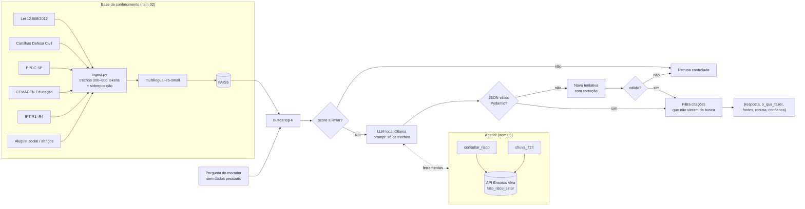
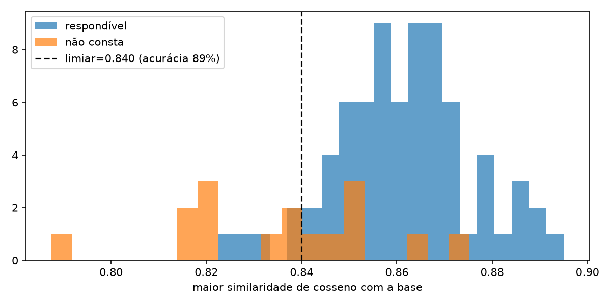

# Assistente Encosta: LLM local com RAG para risco de deslizamento

**FIAP · Global Solution 2026.2 · CitizenTech · Engenharia de Software 4º ano**
Disciplina: **Generative AI for Engineering**. Professor: Francisco Elanio Bezerra.
Componente **Inteligência** do produto **Encosta Viva**.

> Orientação geral baseada em documentos oficiais. Não substitui a Defesa Civil. **Em emergência ligue 199 ou 193.**

---

## 1. Integrantes

| Nome completo | RM |
|---|---|
| PREENCHER | RM00000 |
| PREENCHER | RM00000 |
| PREENCHER | RM00000 |
| PREENCHER | RM00000 |
| PREENCHER | RM00000 |

## 2. Ficha Técnica

| Campo | Descrição |
|---|---|
| Nome do produto | Encosta Viva |
| Cidadão e território | Moradores de setores de risco R3/R4 em encostas urbanas (Litoral Norte de SP, Grande SP, Petrópolis) e agentes da Defesa Civil municipal |
| Problema, em uma frase | Quem mora em encosta recebe alertas genéricos, tarde, e sem saber o que fazer |
| O que a IA resolve | Responde em linguagem simples dúvidas sobre sinais de risco, o que fazer, direitos e níveis de alerta. Sempre cita o documento oficial e **recusa** quando a resposta não está na base |
| Modelo | LLM local `qwen2.5:3b` via Ollama (CPU) |
| Embeddings / índice | `intfloat/multilingual-e5-small` + FAISS (cosseno) |
| Especialização | Agente com ferramentas `buscar_base`, `consultar_risco` e `chuva_72h`, integrado à API do produto |
| Contrato | `POST /assistente/perguntar` → `{resposta, o_que_fazer[], fontes[], recusa, confianca}` |
| URL do MVP / repositório | PREENCHER |
| ODS | 11 (meta 11.5), 13 (meta 13.1), 3, 9, 10 |

## 3. Pipeline de IA



## 4. Base de conhecimento

Gerada por `notebooks/01_base_conhecimento.ipynb`. As fontes estão em [`base/fontes.csv`](base/fontes.csv).

Acesso em 05/11/2026. Trechos de 283 a 400 palavras (~380–530 tokens), com sobreposição de 60 palavras e quebra contínua entre páginas. Cada trecho guarda `pagina` e `pagina_fim`.

| doc_id | Fonte | Formato | Licença | Nº de trechos |
|---|---|---|---|---|
| lei_12608_2012 | Lei 12.608/2012 (PNPDEC), Planalto | HTML→TXT | Domínio público | 22 |
| cartilha_dc_sp | "Como evitar deslizamento", Coordenadoria Estadual de Defesa Civil SP | PDF | Material público, uso educacional | 1 |
| ppdc_santos | PPDC de Santos, Decreto 7.931/2017 (só as págs. 1–5 do Diário Oficial) | PDF | Ato oficial, domínio público | 10 |
| ppdc_sp_2018_2019 | PPDC Operação Chuvas de Verão (apresentação, São Bento do Sapucaí) | PDF | Material público, uso educacional | 1 |
| cemaden_educacao | "Prevenção de deslizamentos se aprende na escola" (CEMADEN, 2023) | PDF | Material público, uso educacional | 28 |
| ipt_mapeamento_riscos | Cerri et al. (2007), metodologia IPT/Ministério das Cidades, graus R1–R4 | PDF | Acesso aberto, uso educacional | 11 |
| aluguel_social_municipio | PENDENTE: Lei 2.433/2017 e Lei 3.119/2025 de São Sebastião | TXT | Domínio público | — |
| **Total** | | | | **73** |

**Limitações da base:**
- O livro "Mapeamento de Riscos em Encostas e Margens de Rios" (2007) não foi encontrado em versão aberta. O artigo de Cerri et al. descreve a mesma metodologia.
- Os documentos do PPDC são de 2017–2019. Os limiares estaduais atuais estão nas resoluções da Casa Militar de 15/10/2026.
- A apresentação do PPDC é quase toda imagem; só 1 trecho tem texto extraível, e o restante exigiria OCR.
- O folheto da Defesa Civil de Itupeva foi baixado, mas ficou fora da base: ele repete 80% do texto do folheto estadual.

## 5. Busca e limiar

A busca é **híbrida**: embeddings `intfloat/multilingual-e5-small` + FAISS (similaridade de cosseno), fundidos com BM25 por Reciprocal Rank Fusion (k=60). Medido sobre as 74 perguntas respondíveis, cada uma com os `chunk_ids` do gabarito.

**Comparação de configurações** (mesmos 73 trechos, mesmo gabarito; arquivo [`comparacao_busca.json`](avaliacao/resultados/comparacao_busca.json)):

| Configuração | recall@1 | recall@3 | recall@5 | Tempo de indexação + 90 consultas (CPU) |
|---|---|---|---|---|
| BM25 | 0,41 | 0,70 | 0,78 | <1 s |
| multilingual-e5-small | 0,42 | 0,64 | 0,78 | 10 s |
| **multilingual-e5-small + BM25 (escolhida)** | **0,50** | **0,72** | **0,86** | 10 s |
| multilingual-e5-base + BM25 | 0,49 | 0,76 | 0,84 | 55 s |
| bge-m3 + BM25 | 0,43 | 0,68 | 0,81 | 154 s |

- **Por que essa configuração:** a busca híbrida corrigiu as perguntas com termo exato ("embarrigado", "desalojado", "Decreto 7.931") que o modelo denso perdia. Os modelos maiores não compensaram o custo em CPU.
- **TOP_K = 5:** o LLM recebe 5 trechos, porque o recall@5 (0,86) é bem maior que o recall@3 (0,72).

**Ajuste final da busca** (feito na correção do erro nº 1, seção 7):
- remoção de ruído dos documentos (cabeçalho de imprensa da cartilha e um decreto sem relação no Diário Oficial de Santos);
- radical simples no BM25 (prefixo de 5 letras), para "rachadura" casar com "rachaduras".

| Busca híbrida | recall@1 | recall@3 | recall@5 |
|---|---|---|---|
| Antes do ajuste | 0,50 | 0,72 | 0,86 |
| **Depois do ajuste (final)** | **0,55** | **0,80** | **0,86** |

A comparação de modelos acima foi feita antes do ajuste.

Também testei garantir no contexto os 2 primeiros de cada buscador (BM25 e denso). Isso trazia a cartilha para a pergunta da rachadura, mas **baixava o recall@5 geral para 0,85**, então não foi adotado: seria ajustar a busca para uma pergunta só.

**Recall por grupo** (final):

| Grupo | recall@1 | recall@3 | recall@5 |
|---|---|---|---|
| sinais_de_risco | 0,69 | 0,75 | 0,81 |
| o_que_fazer | 0,61 | 0,94 | 0,94 |
| direitos | 0,37 | 0,79 | 0,89 |
| niveis_de_alerta | 0,57 | 0,71 | 0,81 |

**Limiar de recusa = 0,84**, sobre a maior similaridade de cosseno entre a pergunta e a base. O score do RRF não serve para isso, porque depende só da posição no ranking.



**Justificativa do limiar:**
- 0,84 é o ponto de maior acurácia (89%) na separação entre respondíveis e "não consta".
- Ele mantém **71/74 respondíveis (96%)** e barra **9/16 "não consta" (56%)**, que são as perguntas fora do tema (futebol, RG, remédio, Manaus, Porto Alegre…).
- As 7 que passam são do tema, mas pedem um fato ausente da base: nível atual em Ubatuba, mortes em Petrópolis, limiar do Litoral Norte. A similaridade não separa essas perguntas, então a recusa funciona em **duas camadas**: o limiar barra o que está fora de escopo, e a instrução "use apenas os trechos" barra o resto. O placar (seção 6) mede a segunda camada.
- As 3 respondíveis barradas (q023, q025, q044) são perguntas curtas e coloquiais. Elas são candidatas à análise de erros.

**Limitações da busca:**
- Trechos genéricos do e-book do CEMADEN (ficha catalográfica, oficinas, bibliografia) aparecem com frequência no top-3.
- O trecho `ppdc_santos_0010` mistura o PPDC com um decreto sem relação, que veio na mesma página do Diário Oficial.
- Remover esses trechos de baixo valor é a próxima melhoria proposta.

## 6. Performance: placar das três configurações

Gerado por `notebooks/05_placar.ipynb` e salvo em [`avaliacao/placar.csv`](avaliacao/placar.csv). As definições das métricas estão em [`src/assistente/evaluate.py`](src/assistente/evaluate.py).

Configuração do placar:
- 90 perguntas (74 respondíveis e 16 "não consta").
- Modelo avaliado: `qwen2.5:3b` (Ollama, GPU RTX 3050).
- Acerto julgado por um **juiz LLM** (`qwen2.5:7b`), que compara cada resposta com o gabarito.
- O juiz foi calibrado em 8 casos com veredito conhecido e concordou em 8.
- Geração e julgamento rodam em fases separadas, para os dois modelos não disputarem a VRAM.

**Placar final (v3, com a correção do erro nº 1):**

| Métrica | Sem contexto | RAG simples | RAG + agente |
|---|---|---|---|
| Acerto (vs. gabarito) | 0,27 | 0,70 | **0,71** |
| Taxa de alucinação (afirma o que não está na base ou erra o gabarito) | 0,32 | 0,24 | **0,23** |
| Recusa correta em "não consta" (n=16) | 0,50 | **0,94** | **0,94** |
| JSON válido na 1ª tentativa | 0,83 | 0,93 | **0,96** |
| Citação correta (`doc_id` veio da busca) | n/a | 1,00 | 1,00 |
| Respostas que mandam **ficar em casa** | **1** (q033) | 0 | 0 |
| Latência média (s, GPU) | 4,0 | 4,7 | 9,8 |

**Acerto por grupo (v3):**

| Grupo | Sem contexto | RAG | Agente |
|---|---|---|---|
| sinais_de_risco | 0,38 | 0,69 | 0,75 |
| o_que_fazer | 0,11 | 0,61 | 0,50 |
| direitos | 0,37 | 0,68 | 0,79 |
| niveis_de_alerta | 0,05 | 0,62 | 0,62 |

**Interpretação:**
- **Com contexto, o acerto chega a 2,6 vezes o do modelo sem contexto** (0,27 → 0,70) e a alucinação cai.
- **Sem contexto, o modelo erra justamente o que é específico:** níveis do PPDC (5% de acerto) e o que fazer (11%). Ele chegou a orientar **"Fique em casa"** para o Alerta Máximo (q033), quando o plano manda ir ao ponto de encontro.
- **Recusa em duas camadas:** o limiar barra as perguntas fora do tema, e a instrução de usar só os trechos barra a maior parte das que são do tema, como "mortes em Petrópolis". O RAG e o agente recusam 15 das 16 "não consta".
- **RAG e agente empatam no acerto geral**, com vantagens diferentes:
  - o agente vai melhor em direitos (0,79) e em sinais de risco, porque o planejador reescreve a pergunta antes de buscar;
  - o RAG vai melhor em "o que fazer" e responde em menos da metade do tempo (4,7 s contra 9,8 s).
- **Recomendação para o produto:** RAG simples no app do cidadão, onde a latência pesa e a salvaguarda garante a segurança, e agente no painel da Defesa Civil e quando há setor informado, porque só ele consulta o risco e a chuva do setor.
- **Variação entre rodadas:** o acerto do agente foi de 0,74 (v2) para 0,71 (v3). Nessa troca, 8 perguntas passaram a acertar e 11 passaram a errar, e a maior parte delas não tem relação com as mudanças da v3 (por exemplo, "2.200 famílias" virou "04 famílias" na q073). Por isso, diferenças de até cerca de ±0,04 (umas 3 perguntas) devem ser lidas como variação de rodada (temperatura 0,1 e juiz LLM), não como efeito de uma mudança. Repetir o placar algumas vezes e reportar a média é a melhoria proposta.
- **Ressalva sobre o juiz:** ele é rigoroso e reprova respostas certas mas incompletas ou com outras palavras. Exemplo: a q017 do agente orienta "procurar um local seguro" e foi reprovada porque o gabarito diz "sair imediatamente". Ele pesa igual nas 3 configurações, então a comparação continua válida, mas os acertos absolutos estão subestimados.

**Evolução das rodadas** (todas guardadas em [`avaliacao/resultados/`](avaliacao/resultados/)):

| Rodada | Mudança | Acerto RAG | Acerto agente | Observação |
|---|---|---|---|---|
| v1 | 1ª versão | (inválido) | 0,19 | A métrica por similaridade e5 ≥ 0,85 aprovava respostas erradas ("a cada 24 horas" no lugar de "de 1 em 1 hora"), e o agente não chamava ferramentas (erro nº 5) |
| v2 | Agente em 2 fases, schema contra resposta só com o aviso, juiz LLM | 0,64 | 0,74 | Ainda havia "não saia de casa" (erro nº 1) |
| v3 | Limpeza de ruído, radical no BM25, salvaguarda "fique em casa" | **0,70** | 0,71 | Nenhuma resposta manda ficar em casa |

### Demonstração de alucinações

| Pergunta | Sem contexto | RAG / agente |
|---|---|---|
| Quantas pessoas morreram nos deslizamentos de Petrópolis em 2022? ("não consta") | No teste de bancada antes das correções de prompt, o RAG respondeu **"Morreram 11 pessoas"** (foram mais de 230), citando trechos sem relação | Depois das correções, o RAG **recusou**: "não há informações sobre o número de mortes… nos trechos fornecidos" |
| Com que frequência a Defesa Civil de Santos mede a chuva no Alerta Máximo? | — | v1: **"a cada 24 horas"** ❌. v2 RAG: "de 1 em 1 hora" ✅. O agente v2 ainda respondeu "de forma contínua" ❌ |
| Qual o acumulado de chuva em 72 h que coloca o Litoral Norte em Atenção? ("não consta") | — | RAG e agente: **"60 mm"**, um número de outra região (erro nº 2) |

Os CSVs completos, com resposta, fontes, trechos recuperados e motivo do juiz, estão em [`avaliacao/resultados/`](avaliacao/resultados/).

## 7. Os 5 erros reais

A tabela completa, com resposta, documento, causa e correção, está em [`avaliacao/erros.md`](avaliacao/erros.md).

| # | Erro | Causa | Status |
|---|---|---|---|
| 1 | Mandou **"não saia de casa"** quando a cartilha diz "saia imediatamente" | Chunk ruim (cabeçalho de imprensa) + busca não trouxe o trecho | **Corrigido:** limpeza + radical + salvaguarda determinística. Na v3, zero respostas mandam ficar em casa |
| 2 | Deu "60 mm" para o Litoral Norte (o número é de São José dos Campos) | Limiar + prompt (generalizou outra região) | Não reapareceu na v3; a correção estrutural (validar o local do número) segue proposta |
| 3 | Disse que R1–R4 valem para "72 horas" (o certo é 1 ano) | Chunk ruim (tabela R1–R4 é imagem) | Não reapareceu na v3; transcrever a Tabela 1 segue proposto |
| 4 | Respondeu sobre seguro residencial citando a cartilha, que não fala disso | Limiar + checagem de citação só por `doc_id` | Aberto |
| 5 | Agente nunca chamava ferramentas e recusava tudo | Prompt (JSON obrigatório junto com tools) | **Corrigido:** acerto 0,19 (v1) → 0,74 (v2) / 0,71 (v3) |

## 8. IA responsável e LGPD
- A IA **não decide evacuação**: ela orienta, e quem decide é a Defesa Civil (humano no circuito).
- Nenhum dado pessoal no prompt nem no log. A API recebe só a pergunta e o `setor_id`, e o log grava só modo, setor, latência e recusa.
- O LLM roda **localmente** (Ollama), então nenhuma pergunta sai da infraestrutura do projeto.
- Toda resposta traz o aviso "não substitui a Defesa Civil" e o passo "ligue 199 ou 193".
- Respostas sem fonte válida são convertidas em recusa.

## 9. Como reproduzir

Requisitos: Python 3.11 e [Ollama](https://ollama.com).

```bash
python -m venv .venv
```
```bash
source .venv/bin/activate   # Windows: .venv\Scripts\activate
```
```bash
pip install -r requirements.txt && pip install -e .
```
```bash
cp .env.example .env
```
```bash
ollama pull qwen2.5:3b
```

1. Coloque os documentos em `base/raw/` (veja [`base/raw/LEIA-ME.md`](base/raw/LEIA-ME.md)).
2. Rode os notebooks em ordem: `01` → `02` → `03` → `04` → `05`. Todos estão salvos com as saídas da execução final.
   - O notebook 05 lê o placar final salvo (`RODAR_PLACAR = False`). Para gerar tudo de novo, mude para `True` (cerca de 40 min na RTX 3050).
   - Os notebooks 03 e 04 chamam o LLM ao vivo. As respostas podem variar entre execuções, então o placar do notebook 05 é a medida válida.
3. Ou rode tudo pela linha de comando:

```bash
python -m assistente.ingest
```
```bash
python scripts/medir_busca.py .
```
```bash
python scripts/comparar_busca.py . intfloat/multilingual-e5-small intfloat/multilingual-e5-base BAAI/bge-m3
```
```bash
python -m assistente.evaluate --modos sem_contexto rag agente
```

O `faiss-cpu` ainda não tem versão para Python 3.15. Se a máquina só tiver essa versão, crie um ambiente 3.11 com `uv`:

```bash
pip install uv && uv venv --python 3.11 .venv311 && uv pip install --python .venv311/Scripts/python.exe -r requirements.txt
```

Para subir a API:

```bash
uvicorn assistente.api:app --port 8001
```
```bash
curl -X POST localhost:8001/assistente/perguntar -H "Content-Type: application/json" -d '{"pergunta":"Porta emperrando é sinal de quê?","modo":"rag"}'
```

Para os testes (não precisam do LLM):

```bash
pytest
```

## 10. Estrutura

```
base/        fontes.csv, raw/ (documentos), processed/ (chunks.jsonl, índice)
avaliacao/   perguntas.jsonl (teste), placar.csv, erros.md, resultados/
notebooks/   01–05 com as saídas salvas
src/assistente/
  schemas.py    contratos Pydantic (resposta, trecho, pergunta)
  ingest.py     item 02: trechos com fonte
  retriever.py  item 03: embeddings, FAISS, recall@k, limiar
  rag.py        item 04: geração validada, nova tentativa, recusa
  agent.py      item 05: agente com ferramentas
  evaluate.py   item 06: placar
  api.py        POST /assistente/perguntar
tests/       testes unitários
docs/        imagens do relatório
```

## 11. Conclusão técnica

PREENCHER.

**Links:** Repositório: PREENCHER · Vídeo: PREENCHER
